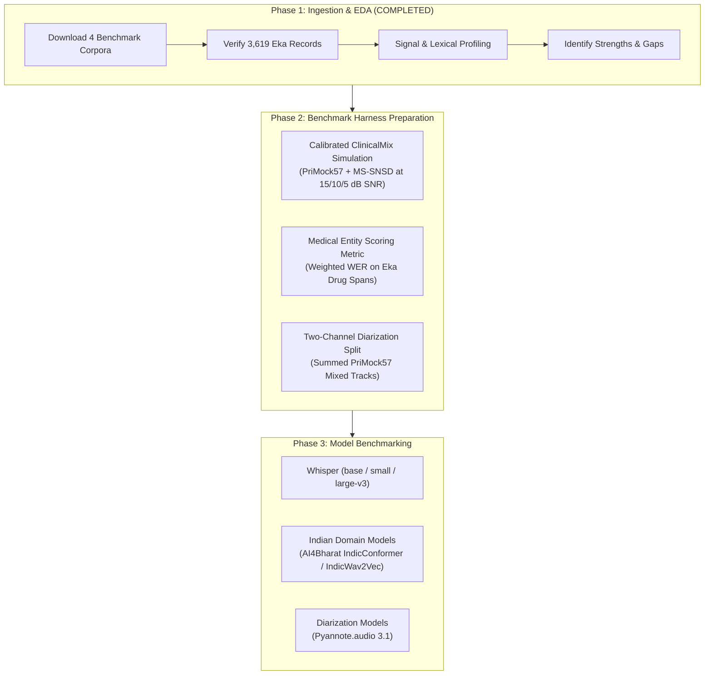

# Medical Voice Scribe: Project-Specific Research Findings & Recommendations

**Document ID**: `eda/reports/project_recommendations.md`  
**Role**: Senior Speech Data Scientist, Audio ML Researcher & Clinical NLP Specialist  
**Project**: Medical Voice Scribe for Indian Clinical Environments  
**Date**: November 2, 2026  

---

## 1. Executive Summary & Research Mandate

The primary goal of this Exploratory Data Analysis was to determine whether our downloaded benchmark datasets (**PriMock57**, **Eka Medical ASR**, **Svarah**, and **MS-SNSD**) provide the empirical foundation required to build and evaluate a **Medical Voice Scribe for Indian Outpatient Departments (OPD)**.

The conclusion of our investigation is that **no single dataset satisfies all project requirements**, but **the four datasets together form a complementary and rigorous benchmarking testbed**, provided each dataset is utilized strictly within its verified scope.

---

## 2. Answers to the Twelve Core Research Questions

### Question 1: Do we have sufficient doctor-patient conversational audio?
* **Answer**: **Yes, for structural and conversational dynamics, but NO for Indian accents.**
* **Evidence**: PriMock57 provides **57 complete clinical consultations** totaling **8.64 hours of continuous dialogue** (17.27 hours dual-channel audio) with 7,109 active turns. This is sufficient to evaluate turn-taking, long-context ASR attention, conversational pauses, and clinical summarization. However, 100% of these consultations are in British English. Eka Medical ASR contributes only 110 conversational dialogue clips (3.0% of its data), which is insufficient for large-scale conversational benchmarking.

---

### Question 2: Do we have Indian-accented medical speech?
* **Answer**: **Yes, for clinician dictations and pharmaceutical terminology, but NO for complete consultations.**
* **Evidence**: Eka Medical ASR contains **3,619 English evaluation recordings** spoken by 57 Indian clinicians and medical students across Indian medical colleges. It provides authentic Indian English pronunciation of generic and branded medications (e.g. Zincovit, Dolo 650, Augmentin). However, 97% of these clips are monologues (isolated drug dictations and prescription sentences), not doctor-patient dialogues.

---

### Question 3: Do we have enough medical vocabulary and drug-name examples?
* **Answer**: **Yes, exceptionally rich for Indian pharmaceutical and outpatient clinical vocabulary.**
* **Evidence**: Eka Medical ASR provides **1,766 audio clips dedicated strictly to medications**, with 1,002 explicit mentions of `tablet`, 140 of `mg`, 114 of `capsule`, and gold-standard annotations for drugs like `antibiotics` (78), `statins` (28), `penicillin` (23), `amlodipine` (16), and `dolo 650` (15). PriMock57 supplements this with 89,147 tokens of UK general practice symptoms (`pain`: 227, `blood`: 120, `chest`: 101, `headache`: 79). Together, they provide ample material for measuring Medical Concept Error Rate (MCER) and Named Entity Recognition (NER) recall.

---

### Question 4: Can we evaluate doctor-patient speaker separation?
* **Answer**: **Yes, with high empirical rigor on PriMock57.**
* **Evidence**: PriMock57 was recorded with two isolated directional microphones worn by the doctor and patient. The two tracks are time-synchronized to within **0.02 seconds** on average. By summing the two tracks ($y(t) = s_{\text{doc}}(t) + s_{\text{pat}}(t)$), we create a synthetic single-microphone room recording while preserving 100% ground truth on:
  1. **Speaker Diarization Error Rate (DER)**: Who spoke when.
  2. **Speaker Role Attribution Accuracy**: Correctly classifying Channel 1 turns as `Doctor` and Channel 2 turns as `Patient`.

---

### Question 5: Do we have enough background noise data?
* **Answer**: **Yes, for office and environmental noise, but with caveats.**
* **Evidence**: MS-SNSD provides **179 verified noise files** totaling **3.95 hours** of ambient noise at 16,000 Hz mono. It contains 28 distinct sound classes, including key outpatient acoustic distractors: `Babble` (20 files, 1,237s), `NeighborSpeaking` (14 files, 1,116s), `AirConditioner` (20 files, 851s), `Typing` (12 files, 929s), and `ShuttingDoor` (18 files, 499s). This is more than sufficient for simulating acoustic corruption.

---

### Question 6: Can we construct controlled noisy clinical conversation benchmarks?
* **Answer**: **Yes, this is one of the strongest capabilities enabled by our current inventory.**
* **Evidence**: All datasets natively share the exact same audio specification: **16,000 Hz, 1-channel Mono, 16-bit PCM**. Furthermore, speech and noise RMS levels naturally align within a tight 2.4 dB window (-23.3 dBFS for PriMock57 vs -22.7 dBFS for MS-SNSD). We can programmatically synthesize controlled OPD benchmarks by mixing clean PriMock57 or Eka speech with MS-SNSD babble and HVAC noise at exact calibrated SNR targets (e.g. 15 dB, 10 dB, 5 dB) using the active speech RMS formula established in `eda/reports/ms_snsd_eda.md`.

---

### Question 7: Are the datasets suitable for evaluating English ASR?
* **Answer**: **Yes, highly suitable across three complementary dimensions.**
* **Evidence**:
  1. *Acoustic & Accent Robustness*: Evaluated via Svarah (6,656 utterances across 19 regional Indian L1 mother tongues).
  2. *Medical Terminology & Prescription ASR*: Evaluated via Eka Medical ASR (3,619 clinical dictations with tagged drug entities).
  3. *Conversational Turn-Taking & Diarization*: Evaluated via PriMock57 (57 complete multi-turn visits).

---

### Question 8: What limitations prevent us from evaluating Hindi and Kannada?
* **Answer**: **A severe scarcity of native language clinical conversational data.**
* **Evidence**:
  1. *Kannada*: Current inventory contains **0 audio files and 0 text sentences in the Kannada language**. Svarah includes 577 clips from native Kannada speakers, but they are speaking *English*, not Kannada.
  2. *Hindi*: Eka Medical ASR provides only **320 short dictation clips** in Hindi (`hi/test-00000.parquet`, 42.5 MB). There are **zero Hindi doctor-patient dialogues** and zero code-switched Hindi-English (Hinglish) consultations.
  * **Conclusion**: The current inventory can benchmark Indian-accented English speech, but cannot evaluate Hindi or Kannada clinical transcription or code-switching.

---

### Question 9: Which dataset is most useful for each project requirement?
* **Requirement 1 (Accept WAV audio)**: All four datasets (100% 16 kHz WAV compatible).
* **Requirement 2 (Accurate speech-to-text)**: Svarah (general accents) + Eka (medical terms).
* **Requirement 3 (Distinguish Doctor vs. Patient)**: **PriMock57** (exclusive source of ground truth).
* **Requirement 4 (Handle Indian English accents)**: **Svarah** (19 native languages) + Eka.
* **Requirement 5 (Medical terms, drugs, dosages)**: **Eka Medical ASR** (1,766 drug clips, dosage units).
* **Requirement 6 (Hindi & Kannada support)**: Eka (preliminary Hindi dictation only; Kannada blocked).
* **Requirement 7 (Handle background noise)**: **MS-SNSD** (noise injection source).
* **Requirement 8 (Avoid transcribing background speech)**: **MS-SNSD Babble/NeighborSpeaking** (as competing distractor speech).
* **Requirement 9 (Speaker-labelled transcript)**: **PriMock57** (TextGrid aligned dialogue turns).

---

### Question 10: What additional data should we collect?
To advance the Medical Voice Scribe toward clinical deployment in India, the team should prioritize collecting:
1. **Indian OPD Doctor-Patient Conversations**: 20–50 recorded consultations in Indian clinical settings (even simulated by Indian medical students/interns) featuring Indian doctor and patient accents.
2. **Clinical Code-Switching (Hinglish / Kanglish)**: Audio of Indian consultations where symptoms, instructions, and history naturally alternate between English and regional languages (Hindi / Kannada).
3. **Authentic Hospital OPD Acoustic Impulse Responses**: Room impulse responses (RIR) and ambient noise captured inside active Indian government civil hospitals or high-volume OPD clinics.

---

### Question 11: What problems should we solve before model benchmarking?
Before running Whisper, Conformer, or diarization pipelines, the engineering team must resolve five preliminary tasks:
1. **Calibrate Energy-Based VAD**: Standard static VAD cutoffs fail on PriMock57 due to -45 dBFS microphone bleed between lapel mics. A dynamic active-RMS ratio ($\ge 0.05 \times \text{peak RMS}$) must be implemented.
2. **Build a Standardized Evaluation Split Harness**: Ensure Eka's 3,619 English clips are partitioned into `narration_entity` (for term accuracy) and `narration_sentence` (for sentence WER).
3. **Exclude MS-SNSD Clean Audio**: Blacklist `voice_scribe_data/ms_snsd/clean_train` (2.09 GB of audiobooks) from all benchmarking scripts to prevent pipeline clutter.
4. **Define Medical-Weighted WER (MWER)**: Standard WER penalizes small function words ("the", "a") equally with critical pharmaceutical names. A medical scoring harness must be configured to weight errors on drug names, dosage numbers, and symptom entities heavily.
5. **Implement Script for Calibrated Acoustic Simulation**: Finalize the mathematical mixing script (`experiments/simulate_clinical_mix.py`) to systematically create 15 dB, 10 dB, and 5 dB SNR test sets from PriMock57 and Eka.

---

### Question 12: What cannot be concluded from the current datasets?
A rigorous researcher must acknowledge the scientific boundaries of their data. The current data **CANNOT**:
1. Prove how an ASR model will perform on an elderly rural Indian patient speaking broken English in a noisy hospital.
2. Prove whether Whisper or any commercial model can transcribe Kannada or Hindi clinical consultations.
3. Prove that zero hallucinations occur when doctors dictate complex multi-drug regimens under real-time acoustic distortion.

---

## 3. Recommended Phased Roadmap

