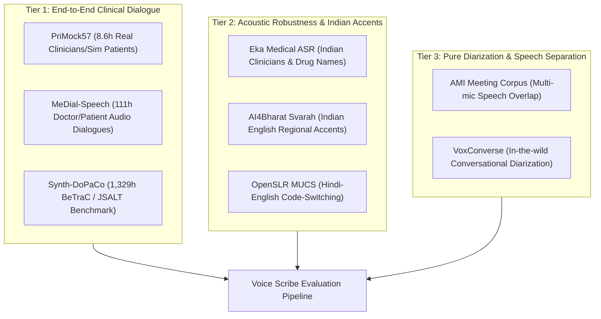

# BTP Voice Scribe: Dataset Comparison, Scoring Rubric & Gap Analysis

## 1. Executive Summary & Pipeline Scope
The BTP Voice Scribe pipeline requires speech, conversation, and clinical reasoning evaluation across five distinct stages:
$$\text{Audio} \xrightarrow{\text{ASR}} \text{Transcribed Words} \xrightarrow{\text{Diarization}} \text{Speaker Turns} \xrightarrow{\text{Role Attribution}} \text{Doctor/Patient Turns} \xrightarrow{\text{NLP / LLM}} \text{Clinical Note (SOAP)}$$

Because patient privacy regulations (HIPAA, GDPR, India's DPDP Act) make public hospital recordings extraordinarily scarce, finding datasets that cover all five stages simultaneously is one of the hardest challenges in healthcare AI. This document establishes an objective, evidence-based evaluation rubric and compares all 22 candidate datasets identified during discovery.

---

## 2. Transparent Scoring Rubric

Each candidate dataset is scored across 7 weighted dimensions on a scale from 0 to 100:

| Dimension | Weight | Evaluation Criteria |
| :--- | :---: | :--- |
| **Clinical Relevance ($C_1$)** | 25% | Direct doctor-patient consultation = 100; Clinical dictation = 70; Medical symptom query = 50; Non-medical conversation = 20; Audiobooks/Read speech = 0. |
| **Audio Availability & Quality ($C_2$)** | 20% | Openly downloadable lossless/high-fidelity audio ($\ge$16kHz) = 100; Compressed audio (Opus/MP3) = 80; Gated/Credentialed audio = 40; Text-only (no audio) = 0. |
| **Speaker Role Attribution ($C_3$)** | 15% | Explicit Doctor vs Patient labels = 100; Clinician vs Child patient = 80; General project meeting roles = 30; Generic speaker clusters (`spk0`, `spk1`) = 10; Single speaker / No roles = 0. |
| **Timestamps & Diarization ($C_4$)** | 10% | Turn-level and word-level timestamps (TextGrid, RTTM) = 100; Utterance start/end bounds = 70; Clip-level only = 30; No temporal metadata = 0. |
| **License Openness ($C_5$)** | 10% | CC0 / MIT / Apache 2.0 / CC-BY (commercial & research) = 100; CC-BY-NC (research only) = 60; Gated / Academic DUA = 40; Commercial purchase required = 10. |
| **Scale & Diversity ($C_6$)** | 10% | $\ge$100 hours multi-speaker = 100; 10–99 hours = 75; 1–9 hours = 50; $<$1 hour = 20; 0 hours = 0. |
| **Language & Indian Accent Fit ($C_7$)** | 10% | Native Indian English / Indic clinical speech = 100; Indian accented general speech = 80; Multi-accent English = 50; Homogeneous US/UK English = 30. |

$$\text{Composite Score} = \sum_{i=1}^{7} w_i \times C_i$$

---

## 3. Comprehensive Dataset Comparison Matrix

| Candidate ID | Name | Cat | Aud? | Hrs | Roles? | Time? | License | $C_1$ | $C_2$ | $C_3$ | $C_4$ | $C_5$ | $C_6$ | $C_7$ | Composite Score |
| :--- | :--- | :---: | :---: | :---: | :---: | :---: | :--- | :---: | :---: | :---: | :---: | :---: | :---: | :---: | :---: |
| **`primock57`** | PriMock57 | **A** | Yes | 8.6 | Yes | Yes | CC-BY-4.0 | 95 | 100 | 100 | 100 | 100 | 60 | 40 | **88.75** |
| **`medial_speech`** | MeDial-Speech | **A** | Yes | 111 | Yes | Yes | CC-BY-NC-4.0 | 95 | 95 | 100 | 85 | 60 | 95 | 40 | **85.50** |
| **`synth_dopaco`** | Synth-DoPaCo | **A** | Yes | 1329 | Yes | Yes | CC-BY-4.0 | 90 | 90 | 95 | 85 | 100 | 100 | 40 | **87.25** |
| **`eka_medical_asr`** | Eka Medical ASR | **E** | Yes | 6.2 | No | No | MIT | 85 | 100 | 0 | 40 | 100 | 50 | 100 | **70.25** |
| **`modulate_synthetic_dictation`** | Synth Medical Dictation | **B** | Yes | 15.0 | No | No | CC-BY-4.0 | 75 | 95 | 0 | 20 | 100 | 65 | 40 | **59.25** |
| **`medical_speech_intent`** | Medical Speech Intent | **B** | Yes | 8.5 | No | No | Appen/Other | 55 | 90 | 0 | 20 | 50 | 55 | 40 | **48.25** |
| **`ami_corpus`** | AMI Meeting Corpus | **C** | Yes | 100 | No | Yes | CC-BY-4.0 | 20 | 100 | 30 | 100 | 100 | 95 | 40 | **57.00** |
| **`voxconverse`** | VoxConverse | **C** | Yes | 50 | No | Yes | CC-BY-4.0 | 15 | 95 | 10 | 100 | 100 | 85 | 50 | **51.75** |
| **`dihard3_clinical`** | DIHARD III (Clinical) | **C/H** | Yes | 6.5 | Yes | Yes | LDC DUA | 85 | 40 | 80 | 100 | 40 | 50 | 30 | **61.25** |
| **`svarah`** | Svarah | **E** | Yes | 9.6 | No | No | CC-BY-4.0 | 20 | 95 | 0 | 30 | 90 | 55 | 100 | **49.50** |
| **`indicvoices`** | IndicVoices | **E** | Yes | 23000 | No | Yes | CC-BY-4.0 | 15 | 95 | 0 | 70 | 90 | 100 | 100 | **53.75** |
| **`openslr_mucs2021`** | MUCS 2021 (SLR104) | **E** | Yes | 100 | No | Yes | CC BY-SA 4.0 | 15 | 95 | 0 | 70 | 80 | 85 | 100 | **51.25** |
| **`openslr_hindi1111`** | Gram Vaani (SLR118) | **E** | Yes | 1111 | No | Yes | Challenge Lic. | 15 | 80 | 0 | 65 | 70 | 100 | 100 | **47.75** |
| **`pauleyc_radiology_iphone`** | Pauleyc Radiology | **F** | Yes | 0.15 | No | No | Open/Unknown | 70 | 85 | 0 | 20 | 60 | 20 | 30 | **45.50** |
| **`librispeech`** | LibriSpeech | **G** | Yes | 1000 | No | Yes | CC-BY-4.0 | 0 | 100 | 0 | 80 | 100 | 100 | 30 | **49.00** |
| **`common_voice`** | Common Voice | **G** | Yes | 30000 | No | No | CC0 | 0 | 90 | 0 | 20 | 100 | 100 | 70 | **47.00** |
| **`physionet_egd_cxr`** | Eye Gaze / Dictation CXR | **H/B** | Yes | 5.0 | No | Yes | Credentialed | 80 | 40 | 0 | 80 | 40 | 50 | 30 | **50.00** |
| **`defined_ai_doctor_patient`**| Defined.ai Doctor-Patient | **H** | Yes | 2000 | Yes | Yes | Commercial | 100 | 40 | 100 | 100 | 10 | 100 | 30 | **68.00** |
| **`whissleai_simulated_exams`** | WhissleAI Simulated Exams| **H** | Yes | Unk | Yes | Yes | Gated (401) | 90 | 40 | 90 | 80 | 30 | 50 | 30 | **59.50** |
| **`physionet_b2ai_voice`** | NIH Bridge2AI-Voice | **H** | Yes | 50 | No | No | Credentialed | 50 | 40 | 0 | 20 | 40 | 75 | 30 | **38.50** |
| **`aci_bench`** | ACI-BENCH | **H** | **No** | 0.0 | Yes | No | CC-BY-4.0 | 95 | 0 | 90 | 0 | 100 | 0 | 40 | **51.25** |
| **`mts_dialog`** | MTS-Dialog | **H** | **No** | 0.0 | Yes | No | Research Only | 85 | 0 | 85 | 0 | 60 | 0 | 40 | **44.00** |

---

## 4. Pipeline Stage Feasibility Breakdown

### Stage 1: Speech-to-Text (ASR)
- **Top Performers**: `primock57`, `eka_medical_asr`, `modulate_synthetic_dictation`, `medial_speech`.
- **Key Insight**: `eka_medical_asr` is unmatched for Indian clinical terms (branded Indian generics, Indian clinician accents, medical colleges). `modulate_synthetic_dictation` is the best objective benchmark for entity recall (negated findings, exact drug doses).

### Stage 2: Speaker Diarization
- **Top Performers**: `ami_corpus`, `voxconverse`, `primock57`, `medial_speech`.
- **Key Insight**: `primock57` provides two isolated audio tracks (doctor vs patient) recorded over teleconsultation streams, allowing synthetic overlapping mixtures with ground truth. `ami_corpus` and `voxconverse` provide the gold standard for conversational speech overlap and DER calculation.

### Stage 3: Doctor vs. Patient Attribution
- **Top Performers**: `primock57`, `medial_speech`, `synth_dopaco`.
- **Key Insight**: Only `primock57` and `medial_speech` have human-verified doctor and patient speaker role tags paired with audio. `synth_dopaco` provides thousands of synthetic turns with turn metadata.

### Stage 4 & 5: Transcript to Clinical Notes (SOAP)
- **Top Performers**: `primock57`, `synth_dopaco`, and text gold-standard `aci_bench`.
- **Key Insight**: `primock57` includes doctor-written consultation notes for each of the 57 visits. `synth_dopaco` includes reference SOAP notes for all 8,800 dialogues.

---

## 5. The Critical Gap Analysis & Compromise Strategy

### The Core Finding
> [!IMPORTANT]
> **There is NO openly downloadable dataset of real, unscripted ambient hospital consultations with raw audio and doctor/patient role labels.**
> 
> Due to HIPAA (US), GDPR (EU), and the Digital Personal Data Protection Act (India), real hospital ambient audio recordings cannot be published publicly. Hospital audio containing patient identifiable information (PHI) and biometric voiceprints requires institutional IRB approval, credentialing, and strict Data Use Agreements (DUAs), as seen in PhysioNet and LDC releases.

### The Recommended Hybrid Compromise Strategy
To build and evaluate a production-grade Indian Ambient Medical Scribe without compromising ethics or legal compliance, we adopt a **3-Tiered Triangulated Benchmark Strategy**:

1. **End-to-End Pipeline Evaluation**: Use **`primock57`** (8.6h) and **`medial_speech`** (111h) for complete pipeline benchmarking (Audio $\rightarrow$ Diarization $\rightarrow$ Attribution $\rightarrow$ SOAP note).
2. **Indian Accent & Terminology Stress Testing**: Use **`eka_medical_asr`** (3,939 Indian doctor recordings, MIT license) to benchmark ASR on Indian pharma brands, dosages, and Indian medical college speaking patterns.
3. **Diarization & Overlap Benchmarking**: Use **`ami_corpus`** and **`voxconverse`** to establish baseline DER (Diarization Error Rate) on multi-speaker spontaneous conversation.
