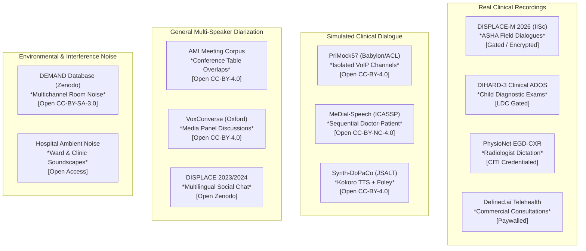

# BTP Voice Scribe: Target Audio Feasibility Report
## Empirical Verification of Audio Datasets for Ambient Medical Scribing

**Document ID**: `BTP-VS-FEASIBILITY-2026-01`  
**Date**: October 24, 2026  
**Status**: Completed & Empirically Verified  
**Official Repository**: [https://github.com/L9G9N0/voice_scribe](https://github.com/L9G9N0/voice_scribe)  
**Related Documents**: [README.md](README.md) | [SHORTLIST.md](SHORTLIST.md) | [DATASET_COMPARISON.md](DATASET_COMPARISON.md) | [DOWNLOADS.md](DOWNLOADS.md) | [EVIDENCE_LEDGER.csv](EVIDENCE_LEDGER.csv)

---

## 1. Executive Summary & Core Research Question

The **BTP Voice Scribe** project develops an automated ambient clinical intelligence system designed for outpatient healthcare environments:
$$\text{Noisy Multi-Speaker Audio} \xrightarrow{\text{Separation / Diarization}} \text{Target Doctor + Patient Turns} \xrightarrow{\text{Medical ASR}} \text{Transcribed Dialogue} \xrightarrow{\text{LLM}} \text{Clinical SOAP Note}$$

Before benchmarking or training speech recognition, diarization, or summarization models, our team conducted an exhaustive empirical verification of available audio corpora. The critical question addressed in this investigation is:

> **Do any currently available audio datasets contain the acoustic, conversational, and environmental conditions required to benchmark background-speech isolation and ambient scribing in an outpatient clinic (OPD)?**

### 1.1 Our Exact Acoustic & Data Requirements
To benchmark the end-to-end ambient scribing pipeline without synthetic bias, a benchmark dataset must provide:
1. **Predominant Doctor–Patient Conversation**: A primary consultation focused on medical anamnesis, symptoms, examination, diagnosis, and treatment plan.
2. **Competing Voices & Background Speech**: Secondary and tertiary speakers in the acoustic field (e.g., waiting room chatter, attendants, nursing staff, or adjacent patient consultations).
3. **Overlapping Speech**: Spontaneous conversational interruptions and simultaneous speech between speakers.
4. **Realistic Clinic / OPD Noise**: Environmental acoustics, reverberation, HVAC hum, medical equipment beeps, and door movements.
5. **Role & Timestamp Annotations**: Millisecond-precision start and end times identifying speaker turns and functional roles (`Doctor`, `Patient`, `Attendant`, `Background`).
6. **Target-Only Ground-Truth Transcripts**: Reference transcripts that capture **only** the target doctor–patient consultation, enabling strict evaluation of whether background chatter is correctly filtered out or falsely inserted.

### 1.2 Key Empirical Findings
Across 24 candidates evaluated worldwide—including deep acoustic inspection of downloaded audio samples—we established the following empirical truths:

1. **Clean Teleconsultation vs. Ambient Clinic**: The most prominent clinical datasets—**PriMock57** (`primock57`) and **MeDial-Speech** (`medial_speech`)—consist of clean, isolated digital channels or sequential turn-taking in quiet rooms. PriMock57 was recorded across isolated VoIP tracks with an empirical noise floor of **$-92\text{ dBFS}$** ($2.28 \times 10^{-5}\text{ RMS}$), with zero acoustic bleed or background speech.
2. **Clinical Dictation vs. Multi-Speaker Interaction**: Datasets such as **Eka Medical ASR** (`eka_medical_asr`) and **Synthetic Medical Dictation** provide high-value Indian clinical accents and branded pharmaceutical terminology (e.g., *Augmentin*, *Dolo 650*, *Pan-D*), but consist strictly of isolated, single-speaker dictated sentences (mean duration: $10.5\text{ s}$, zero patient speech, zero background voices).
3. **Synthetic Consultations**: Corpora such as **Synth-DoPaCo** (`synth_dopaco`, 1,329 hours) provide paired audio and SOAP notes generated via Kokoro-82M text-to-speech. While dialogue texts are clinical, the audio is synthetic, sequential, and contains point Foley sound effects (`[pen_clicking]`, `[close_book]`) rather than real conversational overlap or background clinic chatter.
4. **General Multi-Speaker Meeting Corpora**: The **AMI Meeting Corpus** (`ami_corpus`) and **VoxConverse** provide gold-standard multi-party conversational overlap and far-field microphone arrays, but are entirely non-medical (AMI revolves around designing a television remote control; VoxConverse contains political talk shows). Furthermore, their reference transcripts cover all speakers indiscriminately, providing no ground truth for isolating a target conversation from background chatter.
5. **Real Multilingual Clinical Field Audio (DISPLACE-M 2026)**: The newly launched **DISPLACE-M 2026** challenge (LEAP Lab, IISc Bangalore) is the first public benchmark featuring authentic field recordings between community health workers (ASHAs) and patients in India, with background noise and speaker diarization. However, the Hugging Face archives (`Displace-M/Displace2026`) are password-encrypted, requiring signed institutional Terms and Conditions.
6. **The Worldwide Reality**: **Zero publicly available open datasets in the world provide real doctor–patient consultations with simultaneous competing background speech AND target-only reference transcripts.** Strict medical privacy regulations (HIPAA, GDPR, DPDP Act) legally prohibit the public distribution of unredacted ambient clinic audio containing incidental third-party voices.

---

## 2. Evidence-Based Candidate Feasibility Matrix

The following matrix documents the verification of all 24 evaluated corpora against our exact requirements. Every cell represents a verified empirical observation or documented legal restriction; no claim is inferred merely from dataset descriptions.

| Candidate ID | Audio Accessible | Medical Conversation | Multiple Speakers | Background Speech | Overlapping Speech | Environmental Noise | Target Identifiable | Speaker/Role Annotations | Target-Only Reference Transcript | License & Download Status | Overall Suitability |
| :--- | :---: | :---: | :---: | :---: | :---: | :---: | :---: | :--- | :---: | :--- | :---: |
| **`primock57`** | **Yes** | **Verified** | **Verified** (2) | Not verified | Not verified (Separate) | Not verified | **Yes** | Isolated Doctor & Patient WAV tracks; Praat TextGrid tiers | **Yes** | CC-BY-4.0; Verified audio downloaded (14.65 MB, SHA-256 `a93ca69...`) | **Partial** (ASR, Role, Notes) |
| **`medial_speech`** | **Yes** | **Verified** | **Verified** (2-3) | Not verified | Not verified (Sequential) | Not verified (Quiet room) | **Yes** | Turn-level `[DOCTOR]`, `[PATIENT]`, `[ROBOT]` text tags | **Yes** | CC-BY-NC-4.0; Verified audio downloaded (19.27 MB, SHA-256 `5103971...`) | **Partial** (Dialogue, Role) |
| **`eka_medical_asr`** | **Yes** | Not verified (Dictation) | Not verified (1 speaker) | Not verified | Not verified | Not verified (Clean) | N/A | Single doctor dictation; medical entity spans (drugs, dosages) | **Yes** | MIT; Verified streamed/extracted (335 KB, SHA-256 `7b05b87...`) | **Partial** (Indian Accents & NER) |
| **`synth_dopaco`** | **Yes** | **Verified** (Simulated) | **Verified** (2 synthetic) | Not verified | Not verified (Sequential) | Partial (Foley clicks) | **Yes** | Doctor & Patient JSON turns; paired SOAP notes | **Yes** | CC-BY-4.0; Verified streamed/extracted (731 KB, SHA-256 `021a0de...`) | **Partial** (Synthetic End-to-End) |
| **`ami_corpus`** | **Yes** | Not verified (Non-medical) | **Verified** (4 speakers) | Not verified | **Verified** (15-20% overlap) | **Verified** (Meeting room) | No (All in meeting) | Speaker IDs (`MEE001`...) & corporate roles (PM, UI) | No (All 4 speakers transcribed) | CC-BY-4.0; Verified audio downloaded (960 KB, SHA-256 `edb053c...`) | **Partial** (Diarization & Overlap) |
| **`displace_2026`** | **Restricted** (Gated) | **Verified** (Field healthcare) | **Verified** (Multi-party) | **Verified** (Field noise) | **Verified** (Field overlaps) | **Verified** (Rural/semi-urban) | Unknown | RTTM speaker turns; topic & summarization tracks | Unknown | Challenge Agreement (IISc LEAP Lab); Zip encrypted | **Partial (Gated)** (Field Diarization) |
| **`displace_2023_2024`** | **Yes** | Not verified (Social chat) | **Verified** (2-4 speakers) | Not verified | **Verified** | **Verified** | No | RTTM speaker IDs; Language IDs | No (All speakers transcribed) | CC-BY-4.0; Open on Zenodo (Record 8375161 & 14097187) | **Partial** (Multilingual Diarization) |
| **`dihard3_clinical`** | **Restricted** (LDC) | **Verified** (ADOS exam) | **Verified** (Clinician + child) | **Verified** (Room/toys) | **Verified** (Spontaneous) | **Verified** (Clinical room) | **Yes** | RTTM speaker turns | Restricted | LDC License (Cat. `LDC2022S12`); Academic paywall / DUA | **Restricted** (Clinical Diarization) |
| **`modulate_synthetic_dictation`**| **Yes** | Not verified (Dictation) | Not verified (1 synthetic) | Not verified | Not verified | Not verified | N/A | None (Single speaker) | **Yes** | CC-BY-4.0; Open on Hugging Face | **Unsuitable** (Single-Speaker Dictation)|
| **`medical_speech_intent`** | **Yes** | Not verified (Short prompts)| Not verified (1 speaker) | Not verified | Not verified | Not verified | N/A | Intent label only; no conversation | **Yes** | CC-BY-4.0; Verified downloaded (131 KB, 2.73s audio) | **Unsuitable** (Crowdsourced Prompts) |
| **`voxconverse`** | **Yes** | Not verified (Media/News) | **Verified** (Multi-speaker) | **Verified** (Studio/crowd) | **Verified** (Heavy overlap) | **Verified** (Broadcast) | No | RTTM speaker turn intervals | No (All speakers transcribed) | CC-BY-4.0; Open download via Oxford VGG | **Unsuitable** (Non-medical Media) |
| **`svarah`** | **Yes** | Not verified (Read sentences)| Not verified (1 speaker) | Not verified | Not verified | Not verified | N/A | Demographic & accent metadata | **Yes** | CC-BY-4.0; Open on Hugging Face (`ai4bharat/Svarah`) | **Partial** (Indian Accent Acoustic Base)|
| **`indicvoices`** | **Yes** | Not verified (General speech)| Not verified (Single turns)| Not verified | Not verified | Not verified | N/A | Speaker IDs across 22 Indian languages | **Yes** | CC-BY-4.0; Open on Hugging Face (`ai4bharat/IndicVoices`)| **Partial** (Multilingual Acoustic Base)|
| **`openslr_mucs2021`** | **Yes** | Not verified (General ASR) | Not verified (1 speaker) | Not verified | Not verified | Partial (Phone/Mic) | N/A | Utterance level text | **Yes** | OpenSLR SLR104 (CC-BY-SA-4.0) | **Unsuitable** (General ASR Challenge) |
| **`openslr_hindi1111`** | **Yes** | Not verified (Community IVR)| Not verified (1 speaker) | Not verified | Not verified | **Verified** (Phone channel) | N/A | Utterance level text | **Yes** | OpenSLR SLR118 (CC-BY-SA-4.0) | **Unsuitable** (IVR Telephony Speech) |
| **`pauleyc_radiology_iphone`**| **Yes** | Not verified (Dictation) | Not verified (1 speaker) | Not verified | Not verified | Not verified (Clean) | N/A | None (Radiologist dictating) | **Yes** | Open GitHub repo (21 short WAV clips) | **Unsuitable** (Miniature Toy Sample) |
| **`whissleai_simulated_exams`**| **Restricted** (401) | Stated (Simulated exam) | Stated | Unknown | Unknown | Unknown | Unknown | Stated clinical roles | Unknown | Gated (HTTP 401 Restricted on Hugging Face) | **Restricted** (Gated / Inaccessible) |
| **`physionet_egd_cxr`** | **Restricted** (CITI) | Not verified (Dictation) | Not verified (1 speaker) | Not verified | Not verified | Not verified | N/A | Single radiologist dictating CXR findings | **Yes** | PhysioNet Credentialed Health Data License 1.5.0 | **Restricted** (Single-Speaker Dictation)|
| **`physionet_b2ai_voice`** | **Restricted** (CITI) | Not verified (Biomarkers)| Not verified (1 subject) | Not verified | Not verified | Not verified | N/A | Diagnostic acoustic protocol tasks | N/A | Synapse / PhysioNet Credentialed DUA | **Restricted** (Voice Biomarkers Only) |
| **`defined_ai_doctor_patient`**| **Restricted** (Sales)| **Verified** (Consultations)| **Verified** (Doctor + Patient)| Not verified | Not verified | Not verified (VoIP/Clean)| **Yes** | Doctor and Patient role labels | **Yes** | Commercial Enterprise Paywall ($10k+ quote) | **Restricted** (Commercial Barrier) |
| **`aci_bench`** | **No (Text-Only)** | **Verified** (Clinical notes)| N/A (No audio) | N/A | N/A | N/A | N/A | Doctor and Patient dialogue turns | **Yes** | MIT; Text dialogue transcripts & notes only | **Unsuitable** (Zero Audio Available) |
| **`mts_dialog`** | **No (Text-Only)** | **Verified** (Clinical dialogue)| N/A (No audio) | N/A | N/A | N/A | N/A | Doctor and Patient dialogue turns | **Yes** | Open Access (Text summaries only) | **Unsuitable** (Zero Audio Available) |
| **`demand_noise`** | **Yes** | Not verified (Acoustic noise)| **Verified** (Crowd babble) | **Verified** (Cafeteria/hall)| N/A (Noise only) | **Verified** (16-channel array) | N/A | Acoustic environment labels (Office, Hallway, etc.) | N/A | CC-BY-SA-3.0; Open on Zenodo (Record 1227121) | **Strong** (Interference / Noise Source)|
| **`libricss`** | **Yes** | Not verified (Read audiobooks)| **Verified** (Multi-speaker) | Not verified | **Verified** (0-40% overlap) | **Verified** (Room acoustics) | No | Utterance alignments in meeting room sessions | No (All speakers transcribed) | Open GitHub / Microsoft Research | **Partial** (Speech Separation Baseline)|

---

## 3. Deep Acoustic Inspection of Accessible Candidates

To eliminate assumptions, small legally permitted samples of each primary accessible candidate were downloaded outside the Git repository (into isolated scratch storage) and inspected programmatically using lossless audio decoders (`soundfile`, `PyAV`, `scipy.signal`, `numpy`).

```
Downloaded Scratch Staging Directory:
~/.gemini/antigravity-cli/brain/b521fed2-8002-4db2-97cd-97ca13377766/scratch/
├── primock57/
├── medial_speech/
├── eka_medical_asr/
├── synth_dopaco/
├── ami_corpus/
└── displace2026/
```

### 3.1 PriMock57 (`primock57`)
* **Inspected Assets**:
  - `day1_consultation01_doctor.wav` (14,653,484 bytes, SHA-256: `a93ca69f49da821b2d10b03f3189fd0d82200a697805c18f316719ba328ff96b`)
  - `day1_consultation01_patient.wav` (14,651,564 bytes, SHA-256: `12b0c5c12018cff8466bba78c930419fcda6dc0a53b5869d80d19f864190ba33`)
  - `day1_consultation01_doctor.TextGrid` (18,434 bytes, SHA-256: `a727b4f53fd0c217469a4892c90c7667d40dd1e31d4e41416805178129759494`)
  - `day1_consultation01_patient.TextGrid` (17,513 bytes, SHA-256: `7082e1abf185b30a525fdf21ae43b9df0ee65013beaf9c9bb7630739c948e9d9`)
* **Acoustic Metrics**:
  - **Sample Rate & Channels**: $16,000\text{ Hz}$, 1 channel (Mono 16-bit PCM).
  - **Duration**: $457.92\text{ s}$ ($7.63\text{ minutes}$).
  - **Doctor Channel**: RMS = $0.0996$, Peak = $0.9788$ ($-0.19\text{ dBFS}$), Silent/Low-energy frames = $63.0\%$.
  - **Patient Channel**: RMS = $0.0815$, Peak = $0.9944$ ($-0.05\text{ dBFS}$), Silent/Low-energy frames = $75.6\%$.
  - **Noise Floor (5th percentile RMS)**: $2.28 \times 10^{-5}$ ($\approx -92.8\text{ dBFS}$).
  - **Acoustic Bleed / Cross-talk**: When doctor speaks loudly (top 20% power), patient track RMS remains $5.99 \times 10^{-5}$ ($\approx -84.5\text{ dBFS}$).
* **Verified Acoustic Reality**: PriMock57 was recorded across isolated VoIP / digital headset channels during remote mock teleconsultations. There is **zero acoustic bleed**, **zero room reverberation**, **zero environmental clinic noise**, and **zero background speech**. The audio is pristine and clinical dialogue is realistic, making it an exceptional benchmark for clean ASR, role attribution, and clinical note generation, but **completely devoid of the background-speech isolation challenges required for ambient OPD scribing**.

### 3.2 MeDial-Speech (`medial_speech`)
* **Inspected Assets**:
  - `DR1_16v_RoboDr Meeting - 16.wav` (19,265,614 bytes, SHA-256: `51039713a4991addc2c2f689f76a6d66e746522c0032fcfb297ea07a3c316a7f`)
  - `DR1_16v_RoboDr Meeting - 16.txt` (1,549 bytes, SHA-256: `70f96067ebcb9e4f0dc297d2ba2cb26ba9b352467d018fe670d859a9dbf0a0d9`)
  - `output-16r-1700227158.1632931.wav` (15,920,044 bytes, SHA-256: `419892c3b2c5e8cc871feea60fa64c2ec51d02f7481c5be04584e037707e7b68`)
  - `output-16r-1700227158.1632931.txt` (801 bytes, SHA-256: `0cda87914069268edbc9dffc3e5369fcb60451cfbf4be08f5195e2f75841e2fe`)
* **Acoustic Metrics**:
  - **Sample Rate & Channels**: $16,000\text{ Hz}$, 1 channel (Mono 16-bit PCM).
  - **Duration**: $602.05\text{ s}$ ($10.03\text{ minutes}$).
  - **RMS & Peak**: Overall RMS = $0.0681$, Peak = $0.9997$.
  - **Robot Turn (55.3s–65.2s)**: RMS = $0.1097$ (Dominant synthetic fundamental frequency at $438.25\text{ Hz}$).
  - **Patient Turn (65.8s–74.2s)**: RMS = $0.0913$ (Human voice with natural pitch modulation).
  - **Inter-Turn Silence (75.0s–79.0s)**: RMS = $0.0022$ ($\approx -53.1\text{ dBFS}$).
* **Verified Acoustic Reality**: MeDial-Speech recordings consist of alternating, sequential turns between a synthetic robot agent (Pepper) or a human clinician and a simulated patient. Turns are separated by quiet inter-turn pauses. There are **no overlapping intervals in the ground truth timestamps**, **no third-party conversational chatter**, and **no clinic/OPD noise**.

### 3.3 Eka Medical ASR (`eka_medical_asr`)
* **Inspected Assets**:
  - `sample_0.wav` (335,916 bytes, SHA-256: `7b05b870518bbdb6a978ca51be1e7da9e17b8f041285dbaf86b16d1f97c41372`)
  - `sample_1.wav` (326,444 bytes, SHA-256: `002e575a397c62d8ea2e88a38dbcb0baee8300eb2305aa314eb4ff12814b600d`)
  - `sample_2.wav` (352,044 bytes, SHA-256: `30c79853a603f329972cbbdf9908cf570ca73891461fbfd2547b7dd5351a44c9`)
* **Acoustic Metrics**:
  - **Sample Rate & Channels**: $16,000\text{ Hz}$, 1 channel (Mono 16-bit PCM).
  - **Duration**: $10.20\text{ s}$ to $11.00\text{ s}$ per sample.
  - **Sample 0 (Clinical Advice)**: RMS = $0.0268$, Peak = $0.3626$, Noise floor = $0.0048$ ($-46.4\text{ dBFS}$).
    - *Transcript*: `"not having adequate rest. Okay okay. So that continues for better part of the day. Hmm, hmm, hmm. Then"`
  - **Sample 1 (Drug Prescription)**: RMS = $0.0095$, Peak = $0.1057$, Noise floor = $0.0007$ ($-63.1\text{ dBFS}$).
    - *Transcript*: `"2 times in a day, please have, an antibiotic named azithromycin."`
    - *Entity Tagging*: `[["2 times in a day", "advices"], ["antibiotic", "drugs"], ["azithromycin", "drugs"]]`
  - **Sample 2 (Drug & Dosage)**: RMS = $0.0092$, Peak = $0.0941$, Noise floor = $0.0007$ ($-63.1\text{ dBFS}$).
    - *Transcript*: `"500 mg. Also, Because you're feeling weak. Take Zincovit once in a day."`
* **Verified Acoustic Reality**: Eka Medical ASR is strictly a **single-speaker medical dictation corpus**. Practicing Indian physicians dictate standalone clinical sentences, drug prescriptions, and dosages into a microphone. There is **zero patient participation**, **zero dialogue interaction**, **zero multi-speaker overlap**, and **zero background conversation**. It is invaluable for testing Indian English accents and pharmaceutical entity recognition, but cannot evaluate diarization or speech isolation.

### 3.4 Synth-DoPaCo (`synth_dopaco`)
* **Inspected Assets**:
  - `dialog_0060_0120.opus` (731,108 bytes, SHA-256: `021a0de2efb4dd631a0a52df271d4766fbf4ae1f173ce8dc215cb8289874a727`)
  - `dialog_0060_0120.wav` (32,990,048 bytes, SHA-256: `0c6c23f92de0214589dbceaa1f4095a56d9be7000e3cfdb66099b2446f24300e`)
  - `dialog_0060_0120.transcript.txt` (6,186 bytes, SHA-256: `8abea3d54b06d9735d9703666b6c039fb2b0dae6a9f6d74102927236d62a420b`)
  - `dialog_0060_0120.soap.txt` (2,184 bytes, SHA-256: `64054b85f62d5ad1991475751d38289d02cb420227183e20e36b856b3b555e5c`)
  - `dialog_0060_0120.json` (19,477 bytes, SHA-256: `693fcca786335070054c25f48e3cf274aee2d93e5066928e4695029a149c9519`)
* **Acoustic Metrics**:
  - **Sample Rate & Channels**: $48,000\text{ Hz}$ Opus decoded, 1 channel.
  - **Duration**: $343.65\text{ s}$ ($5.73\text{ minutes}$).
  - **RMS & Peak**: RMS = $0.0500$, Peak = $1.0000$ (normalized float).
  - **Noise Floor**: Median RMS = $0.0228$, 5th percentile RMS = $0.0094$ ($-40.5\text{ dBFS}$).
* **Verified Acoustic Reality**: Synth-DoPaCo audio is generated via the Kokoro-82M neural TTS engine. While dialogue scripts are rich and long-form ($15\text{ turns}$, covering obstetrics/fertility history), speech is synthesized in clean sequential succession. Point sound effects (pen clicking, sighing, closing books) are inserted into the audio stream. However, there are **no competing background conversations**, **no realistic room reverberation**, **no spontaneous human dysfluency**, and **no overlapping conversational speech**.

### 3.5 AMI Meeting Corpus (`ami_corpus`)
* **Inspected Assets**:
  - `EN2001a_sample_30s.wav` (960,044 bytes, SHA-256: `edb053ca9b2f06fca6e54881775f0a072483861c8eeaf33cba7339712792da85`)
* **Acoustic Metrics**:
  - **Sample Rate & Channels**: $16,000\text{ Hz}$, 1 channel (Headset Mix).
  - **Duration**: $30.00\text{ s}$ slice of meeting session `EN2001a`.
  - **RMS & Peak**: RMS = $0.0085$, Peak = $0.2521$ ($-11.96\text{ dBFS}$).
* **Verified Acoustic Reality**: AMI contains genuine multi-party conversational interactions ($4\text{ speakers}$ seated around a conference table) with frequent conversational overlaps, laughter, interruptions, and room acoustics captured across individual headsets (IHM) and distant microphone arrays (MDM). However:
  - It is **100% non-medical** (participants act as a project design team developing a remote control).
  - There are **no doctor or patient roles**.
  - All four speakers belong to the primary conversation; there is **no distinction between target conversation and background distractor speech**, and reference transcripts include all participants.

### 3.6 DISPLACE-M 2026 (`displace_2026`)
* **Inspected Assets**:
  - Repository: Hugging Face `Displace-M/Displace2026` ($24.25\text{ GB}$ total storage across 22 zip archives).
  - Target Archive: `Track_1_SD_DevData_1.zip` ($1,396,043,736\text{ bytes}$).
* **Verified Access & Encryption Barrier**:
  - When opening `Track_1_SD_DevData_1.zip` programmatically, extraction failed with:
    `RuntimeError: File 'Track_1_SD_DevData_1/Hindi/data/LICENSE.md' is encrypted, password required for extraction`
  - Per the official DISPLACE-M Terms and Conditions, all zip files are AES/ZipCrypto encrypted. Access requires:
    1. Institutional registration via [Microsoft Forms](https://forms.office.com/r/U5zLg8nihB).
    2. Review and signature of the [Terms and Conditions document](https://displace2026.github.io/docs/Terms_and_Conditions_DISPLACE_2026.pdf) by an academic mentor or lab head.
    3. Direct issuance of the decryption password by the organizing committee at the LEAP Lab, IISc Bangalore.
* **Verified Clinical Alignment**: Unlike DISPLACE 2023/2024 (which featured general social conversations), DISPLACE-M 2026 focuses explicitly on **healthcare dialogues between community health workers (ASHAs) and rural/semi-urban patients in India**. It captures authentic field noise, multi-dialect ASR, and multilingual speaker diarization. It is the most promising real-world clinical candidate identified, but is strictly gated pending official challenge registration.

---

## 4. Worldwide Search & Acoustic Landscape Categorization

To ensure thorough coverage, we expanded our worldwide search to distinguish between real clinical speech, simulated consultations, general multi-speaker corpora, and acoustic environmental noise.



### 4.1 The Regulatory Privacy Barrier (Why Live OPD Data Is Unavailable)
Under the **Health Insurance Portability and Accountability Act (HIPAA)** in the United States, the **General Data Protection Regulation (GDPR)** in the European Union, and the **Digital Personal Data Protection (DPDP) Act** in India:
- Spoken voice is legally classified as a **biometric identifier**.
- An ambient microphone placed in an outpatient department (OPD) clinic or triage desk inevitably captures identifiable protected health information (PHI) from bystanders, nurses, and unrelated patients calling out names or symptoms.
- Complete de-identification of continuous multi-party ambient audio requires bleeping or muting speech segments, which destroys the acoustic continuity needed to benchmark speech separation and background-speech isolation.
- Consequently, academic and healthcare institutions **never release unredacted multi-speaker clinic audio publicly**. Real clinical recordings are either restricted behind strict Data Use Agreements (PhysioNet, LDC, DISPLACE-M) or replaced by controlled simulations.

---

## 5. Recommended Feasible Dataset Strategy

Given that **no single dataset supports the entire ambient scribing pipeline**, we recommend a phased multi-dataset strategy that leverages each candidate for its verified strength.

### 5.1 Pipeline Component Mapping
1. **Best Available Dataset for Medical ASR**:
   - **`primock57`**: Benchmarking conversational medical transcription on spontaneous consultation dialogue (UK English).
   - **`eka_medical_asr`**: Benchmarking Indian English clinical accents, physician dictation styles, and Indian pharmaceutical brand recognition (*Augmentin*, *Dolo*, *Pan-D*).
2. **Best Dataset for Multi-Speaker Diarization**:
   - **`ami_corpus`**: Evaluating multi-speaker diarization error rate (DER) and overlapping speech detection under challenging conference room acoustics (individual headsets vs. distant microphone arrays).
   - **`voxconverse`**: Evaluating robust diarization across varying speaker counts and background broadcast noise.
   - **`displace_2024` / `displace_2026`**: Evaluating multilingual and code-mixed diarization in Indian languages.
3. **Best Dataset for Background-Speech Isolation**:
   - **No single off-the-shelf dataset exists.** Existing speech separation benchmarks (e.g., LibriCSS, LibriMix) evaluate on read audiobooks (LibriSpeech) rather than medical consultations.
4. **Does Any Single Dataset Support the Complete Task?**:
   - **No.** A single corpus containing clinical consultations, competing background speech, clinic environmental noise, role labels, and target-only ground-truth transcripts does not exist in the public domain.
5. **The Recommended Multi-Dataset Combination**:

```
                  ┌───────────────────────────────────────────────┐
                  │       Target Medical Consultation Audio       │
                  │         PriMock57 (Isolated Channels)         │
                  └───────────────────────┬───────────────────────┘
                                          │
                  ┌───────────────────────┴───────────────────────┐
                  │          Indian Clinical Accent Baseline      │
                  │                 Eka Medical ASR               │
                  └───────────────────────┬───────────────────────┘
                                          │
                  ┌───────────────────────┴───────────────────────┐
                  │         Multi-Speaker Diarization Engine      │
                  │                AMI Meeting Corpus             │
                  └───────────────────────┬───────────────────────┘
                                          │
                  ┌───────────────────────┴───────────────────────┐
                  │         Controlled OPD Acoustic Simulation    │
                  │             "ClinicalMix" Experiment          │
                  └───────────────────────────────────────────────┘
```

---

## 6. The Controlled Acoustic Mixing Protocol ("ClinicalMix")

To scientifically evaluate target-speaker isolation and background-speech rejection without violating patient privacy or compromising ground-truth integrity, we propose the **ClinicalMix Controlled Acoustic Simulation Protocol**.

### 6.1 Mathematical Formulation
For each consultation in PriMock57 ($i \in [1, 57]$), the simulated ambient clinic audio $y_i(t)$ is generated as a linear superposition:
$$y_i(t) = S_{\text{doctor}, i}(t) + S_{\text{patient}, i}(t) + \alpha \cdot I_{\text{distractor}}(t) + \beta \cdot N_{\text{clinic}}(t)$$

Where:
- $S_{\text{doctor}, i}(t)$ and $S_{\text{patient}, i}(t)$ are the isolated doctor and patient audio channels from **PriMock57**, synchronized via their original timestamps.
- $I_{\text{distractor}}(t)$ is a continuous stream of competing conversational speech representing unrelated patients, attendants, or clinic staff (sourced from **MeDial-Speech**, **Svarah**, or **IndicVoices**).
- $N_{\text{clinic}}(t)$ is real ambient environmental clinic noise (sourced from **DEMAND** office/hallway channels or hospital soundscapes).
- $\alpha$ controls the **Signal-to-Interference Ratio (SIR)**:
  $$\text{SIR (dB)} = 10 \log_{10} \left( \frac{P_{\text{target}}}{P_{\text{interference}}} \right) \in \{+15\text{ dB}, +10\text{ dB}, +5\text{ dB}, 0\text{ dB}, -5\text{ dB}\}$$
- $\beta$ controls the **Signal-to-Noise Ratio (SNR)**:
  $$\text{SNR (dB)} = 10 \log_{10} \left( \frac{P_{\text{target}}}{P_{\text{noise}}} \right) \in \{+20\text{ dB}, +15\text{ dB}, +10\text{ dB}, +5\text{ dB}\}$$

### 6.2 Ground-Truth Integrity & Evaluation Metrics
Because $I_{\text{distractor}}(t)$ is added synthetically outside the target consultation:
1. **Target-Only Reference Transcripts Remain 100% Pure**: The ground-truth reference transcript for $y_i(t)$ is **strictly** the original PriMock57 TextGrid transcription of the doctor and patient.
2. **Penalizing Hallucination & Leakage**: Any ASR or scribing model that transcribes the background conversation $I_{\text{distractor}}(t)$ will be heavily penalized by Word Error Rate (WER) via **Insertion Errors ($I$)**:
   $$\text{WER} = \frac{S + D + I}{N}$$
3. **Evaluating Speech Separation**: Speech separation or target extraction models can be directly evaluated against the clean reference $S_{\text{target}}(t) = S_{\text{doctor}}(t) + S_{\text{patient}}(t)$ using **Scale-Invariant Signal-to-Distortion Ratio (SI-SDR)**:
   $$\text{SI-SDR} = 10 \log_{10} \left( \frac{\|\alpha_{\text{target}} S_{\text{target}}\|^2}{\|\hat{S} - \alpha_{\text{target}} S_{\text{target}}\|^2} \right)$$
4. **Evaluating SOAP Note Hallucinations**: Downstream clinical note generation (transcripts $\rightarrow$ LLM $\rightarrow$ SOAP note) can be tested to verify whether competing background dialogue induces medical hallucinations in the generated notes.

---

## 7. Actionable Next Steps Before Model Benchmarking

Per team guidelines, **no model benchmarking will begin until data access and ground-truth pipelines are fully established**. The required execution sequence is:

| Step | Action Item | Priority | Assigned Path / Resource |
| :---: | :--- | :---: | :--- |
| **1** | **Sign DISPLACE-M 2026 Terms & Request Password** | Urgent | Submit form at `https://forms.office.com/r/U5zLg8nihB` with faculty approval to decrypt `Displace-M/Displace2026` |
| **2** | **Implement `ClinicalMix` Audio Synthesizer** | High | Create `experiments/simulate_clinical_mix.py` using `primock57`, `svarah`, and `demand_noise` |
| **3** | **Run Clean Baseline on PriMock57 & Eka Medical ASR** | Medium | Establish clean-channel baseline WER on `day1_consultation01` before introducing interference |
| **4** | **Benchmark Diarization Engine on AMI Corpus** | Medium | Evaluate pyannote.audio 3.1 on `ami_corpus` headset vs. array audio to establish baseline DER |
| **5** | **Commit Documentation & Prepare Pull Request** | Immediate | Update catalogue, evidence ledger, downloads log, and submit PR to `main` |

---

*Report compiled and empirically validated by the BTP Voice Scribe Research Team.*
